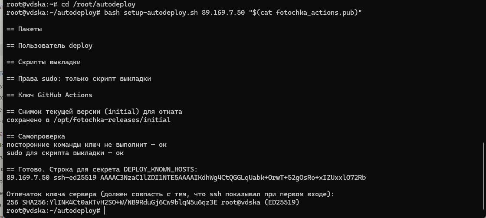
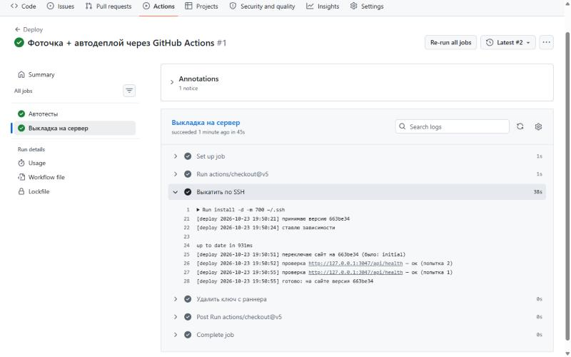
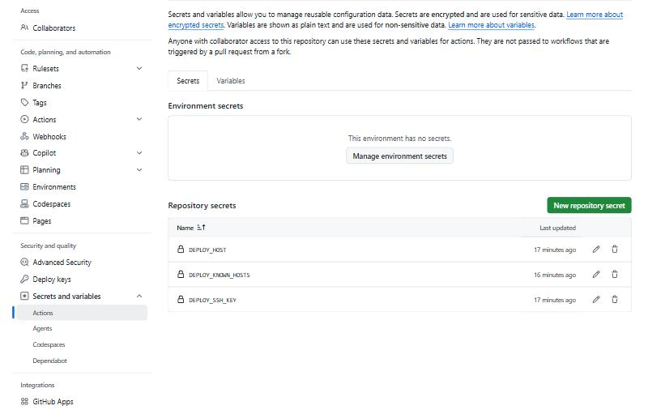
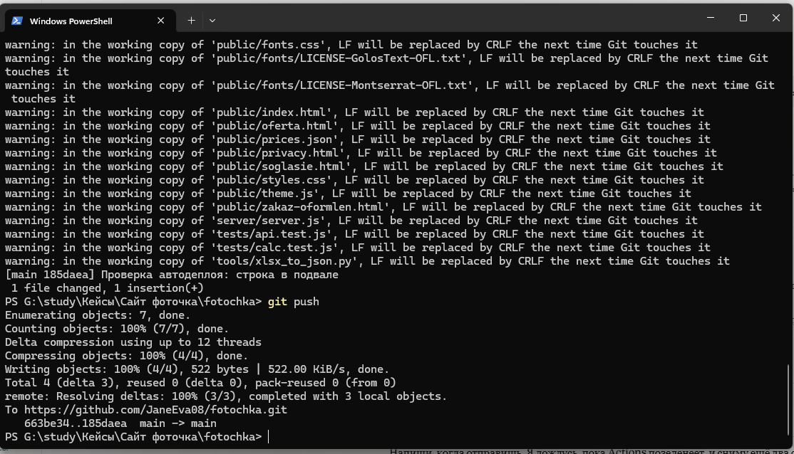
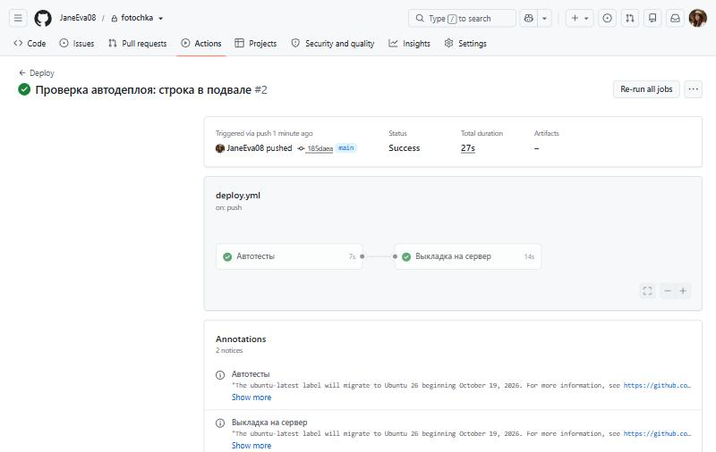

# VPe03. Настройка VPS — отчёт по ДЗ

| | |
|---|---|
| Курс | «Профессия вайб-кодер», Zerocoder |
| Модуль | 6. Серверное развёртывание |
| Урок | VPe03. Настройка VPS |
| Вариант | 2 — адаптировала под свою задачу |
| Проект | Лендинг сервиса фотопечати с калькулятором и приёмом заказов (учебный проект) |
| Сайт | https://foto.janeeva.ru |
| Репозиторий | [JaneEva08/fotochka](https://github.com/JaneEva08/fotochka) |
| Провайдер и сервер | vdska (Россия), Ubuntu, 1 vCPU, 1 ГБ RAM, 15 ГБ диск |
| Автодеплой | GitHub Actions + сервер (вместо Coolify) |
| Дата | 23.10.2026 |

> Я не новичок: уже год прохожу курсы в Zerocoder. Тему урока взяла не на тестовом приложении, а на своём живом проекте: сайт фотопечати, который я сдавала итоговым проектом курса по фрилансу. Этот кейс пойдёт в копилку моего портфолио, поэтому делала его как для заказчика — с автотестами, защитой доступа к серверу, откатом и инструкцией по восстановлению.

---

## 1. Задача и почему не Coolify

Сайт уже работал на VPS: Node.js 22, база заказов SQLite, nginx и HTTPS. Обновляла я его вручную — загрузить файлы на сервер и перезапустить службу. Задача урока — чтобы каждый `git push` сам доходил до сервера.

Coolify, который показан в уроке, я сознательно не стала ставить:

- **Не хватает ресурсов.** По документации Coolify нужно минимум 2 ядра и 2 ГБ памяти, а у моего сервера 1 ядро и 1 ГБ — и на нём уже работает сайт.
- **Конфликт портов.** Coolify ставит свой прокси на порты 80 и 443, а их уже занимает nginx с сайтом. Установка «поверх» уронила бы рабочий сайт.
- **Лишняя система для одного сайта.** Coolify удобен, когда на одном сервере много проектов. Для одного сайта на маленьком сервере проще и надёжнее GitHub Actions: на сервере не появляется ничего, кроме двух небольших скриптов.

Задание это прямо допускает: «Настрой автодеплой через Coolify (или альтернативу: GitHub Actions + сервер)».

---

## 2. Что сделано по пунктам задания

| № | Пункт задания | Как реализовано |
|---|---|---|
| 1 | Выбрать провайдера и конфигурацию VPS под задачу | Российский VPS у vdska: 1 vCPU, 1 ГБ RAM, 15 ГБ. Для лендинга с SQLite этого хватает с запасом (на сервере занято 27 % памяти). Сервер в России — данные заказов не уходят за рубеж (152-ФЗ). |
| 2 | Настроить SSH-доступ и подключиться | Подключение из терминала Windows по SSH. Для GitHub Actions создан отдельный ключ ed25519 (вместо RSA из урока). |
| 3 | Развернуть на сервере свой проект | Сайт работал на сервере как служба systemd за nginx с HTTPS. Код перенесён в репозиторий GitHub. |
| 4 | Настроить автодеплой | GitHub Actions: `git push` → 41 автотест → выкладка на сервер по SSH → проверка, что сайт отвечает. Файл `.github/workflows/deploy.yml`. |
| 5 | README с инструкцией по развёртыванию и восстановлению | [`AVTODEPLOY.md`](AVTODEPLOY.md): разовая настройка, откат, восстановление на новом сервере, таблица ошибок, 152-ФЗ. Первоначальная установка сайта — [`DEPLOY.md`](DEPLOY.md). |
| 6 | Тестовое обновление | Добавила строку в подвал сайта → `git push` → через 27 секунд строка на сайте (скриншоты 4–6). |

---

## 3. Как работает автодеплой

```
git push ──► GitHub Actions ──► 41 автотест ──► архив кода по SSH ──► VPS
                                   │ упали                              │
                                   ▼                                    ▼
                          выкладки нет, сайт        новая версия → /api/health
                          не тронут                     ок → готово
                                                        не ок → автоматический откат
```

На сервере скрипт `fotochka-deploy`:

1. Принимает код новой версии в отдельную папку `/opt/fotochka-releases/<SHA>`.
2. Ставит зависимости — от пользователя сайта, не от root.
3. Копирует код в рабочую папку, **не трогая `.env` (настройки) и `data/` (заказы)**.
4. Перезапускает службу и дважды проверяет `/api/health` с паузой — чтобы поймать версию, которая стартует и сразу падает.
5. Если проверка не прошла — сам возвращает прошлую версию, а запуск в GitHub становится красным.

Хранятся 5 последних версий и снимок `initial` — сайт до подключения автодеплоя. Откат — повторным запуском workflow с нужным коммитом или одной командой на сервере.

---

## 4. Безопасность

Главный вопрос, который я решала: как пустить GitHub на сервер, **не давая ему полный доступ**.

- **Ключ GitHub умеет одно действие.** В `authorized_keys` он прописан с принудительной командой: при подключении запускается только скрипт выкладки. Терминал, туннели и любые другие команды запрещены. Самопроверка при настройке это подтверждает (скриншот 1).
- **Отдельный пользователь `deploy`** без пароля. Через sudo ему разрешена ровно одна команда — скрипт выкладки.
- **Проверка сервера.** Отпечаток сервера хранится в секретах GitHub (`DEPLOY_KNOWN_HOSTS`). Если кто-то подменит сервер, подключение не пройдёт.
- **Секреты не в коде.** Адрес, отпечаток и ключ — в секретах GitHub (скриншот 3). `.env` и база заказов в репозиторий не попадают (`.gitignore`). Если `.env` всё же окажется в репозитории, выкладка остановится с ошибкой.
- **152-ФЗ.** Через GitHub проходит только код. Заказы и настройки остаются на сервере в России.

---

## 5. Проверка

| Что проверяла | Результат |
|---|---|
| Автотесты на серверах GitHub | 41 из 41, 7 секунд |
| Первый запуск без секретов | Тесты зелёные, выкладка красная — ожидаемо, доступа к серверу ещё нет |
| Настройка сервера | Ключ не выполняет посторонние команды, sudo работает только для скрипта выкладки, снимок `initial` сохранён |
| Первая выкладка | Версия `663be34` на сайте, `/api/health` ответил с первой попытки |
| Тестовое обновление | Коммит `185daea` → через 27 секунд строка в подвале на https://foto.janeeva.ru |
| Сломанная версия (на тестовом стенде) | Скрипт сам вернул прошлую версию, сайт продолжил работать, `.env` и заказы не тронуты |
| Повторная выкладка во время другой | Вторая ждёт первую, одновременно не идут |

---

## 6. Что в уроке сделала иначе

| В уроке | Как сделала | Почему |
|---|---|---|
| Ключ RSA 4096 | ed25519 | Короче, быстрее, современнее; в теории урока сам упоминается ed25519 |
| Deploy key с правом записи | Права на запись нет вообще: сервер не ходит в GitHub, код приносит сам GitHub | Если ключ утечёт, через него нельзя изменить код |
| Кодовая фраза ключа пустая «для простоты» | Для ключа Actions — пустой, но ключ умеет только выкладку | Обычный ключ без фразы даёт полный root-доступ при утечке файла |
| Приложение по `http://IP:8080` | По домену с HTTPS через nginx | Без HTTPS данные формы заказа идут открытым текстом |
| Регистрация в Coolify «когда откроется» | — | Первый, кто откроет панель после установки, становится админом. Если ставить Coolify — регистрироваться сразу |
| Docker Desktop на компьютере | Не нужен | Образ собирается на сервере |

---

## 7. Сложности

- **Выбор между Coolify и Actions.** Сначала планировала Coolify, но проверка требований показала, что он не поместится на сервер рядом с работающим сайтом. Пришлось разобраться, что именно делает Coolify, и собрать то же самое из GitHub Actions и скрипта.
- **Доступ GitHub к серверу.** Дольше всего разбиралась, как дать GitHub право выкладывать сайт, не давая полного SSH-доступа. Решение — ключ с принудительной командой и узкое правило sudo.
- **Что считать «успешной выкладкой».** Служба может запуститься и упасть через секунду. Поэтому проверка двойная, а при неудаче — автоматический откат.

---

## 8. Скриншоты

**1. Настройка автодеплоя на сервере по SSH — все самопроверки пройдены**



**2. Первая выкладка в GitHub Actions — лог скрипта на сервере**



**3. Секреты в GitHub — значения скрыты**



**4. Тестовое обновление: коммит и `git push`**



**5. Автодеплой после коммита — тесты и выкладка зелёные, 27 секунд**



**6. Строка из коммита на сайте — в подвале**


